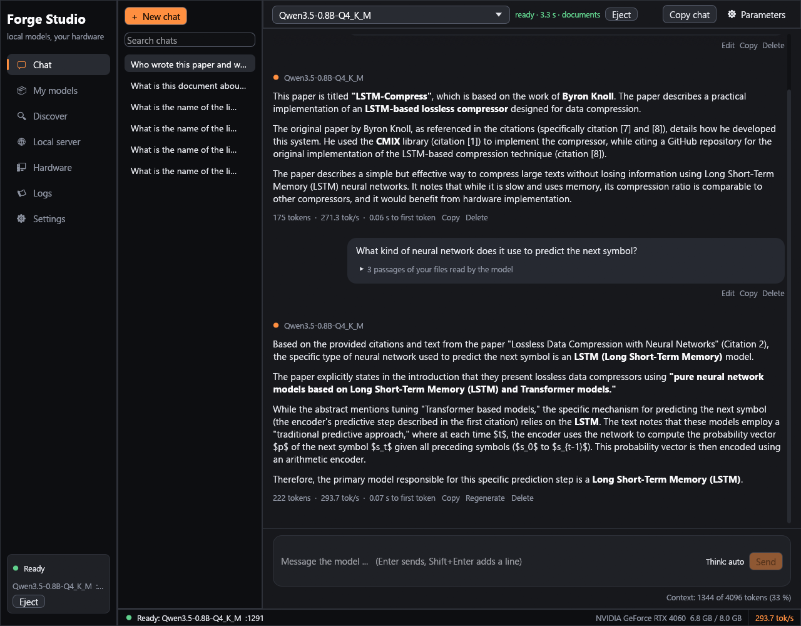

# ForgeInfer and Forge Studio

**Run language models on your own computer: a desktop app in Rust, and an inference engine written from scratch in Rust and CUDA.**

[](https://github.com/AizenKai1001/forgeinfer/actions/workflows/ci.yml)
[](LICENSE)

This repository holds two things that work together:

| | what it is |
|---|---|
| **Forge Studio** (`studio/`) | A desktop app for Windows, Linux and macOS in the style of LM Studio: chat with streaming and Markdown, a model library with a GGUF inspector, Hugging Face search and resumable downloads, a local OpenAI-compatible server, a hardware report, logs and settings. It starts and watches the engine for you. |
| **ForgeInfer** (`crates/`) | The engine behind it: an OpenAI-compatible inference server for GGUF models on NVIDIA GPUs, plus the tokenizer, chat templates, quantizer, trainer and evaluation tools around it. The core crates use **no third-party Rust crates and no llama.cpp code**: the CUDA driver API is loaded at run time and the GPU kernels are our own CUDA C++. |

Forge Studio is not tied to the engine. It also drives llama.cpp's `llama-server`, and it can chat with any server that is already running (Ollama, LM Studio, vLLM, another computer): that is how it works on a Mac today.

## Forge Studio


- **Chat**: streaming answers, Markdown with code blocks, tables and lists, a folded "Thought for N s" block for thinking models with a Think auto/off/on switch beside Send, tokens per second and time to first token under every answer, regenerate, edit and resend, copy, **attach text, code, PDF, Word, Excel, PowerPoint, OpenDocument, RTF, EPUB and HTML files** by dropping them on the window (a file too long for the context is searched instead: **chat with documents**, with an embedding model that runs inside the engine), rename and search chats, chat history on disk (one JSON file per chat).
- **Chat with documents**: drop a PDF, Word, Excel, PowerPoint, OpenDocument, RTF, EPUB, web page, text or code file on the window and ask about it. A file that fits the context goes in whole; a longer one is cut into passages, the engine's own embedding model (nomic-embed-text, read from disk only when a long file is first searched) finds the best ones for each question, and the answer cites the file and the PDF page: a 500 KB file is read in 3 seconds on an RTX 4060. A question about the document as a whole (summary, abstract) gets its opening too.
- **Embedding models**: load nomic-embed-text and the chat screen becomes a playground (type lines, see how close each is to the first one); the same model serves `/v1/embeddings` to other programs.
- **My models**: finds `.gguf` files in your folders, LM Studio's folder and Ollama's store (used in place, nothing is copied). Every card says what is inside (architecture, parameters, quantization, context) and whether it fits your video memory.
- **Model inspector**: take any GGUF apart: layer map (the hybrid pattern of Qwen3.5 shows up as 3 recurrent layers per attention layer), where the bytes are (feed-forward, attention, embeddings), the quantization mix, every metadata key and tensor.
- **Discover**: search Hugging Face for GGUF repositories, see every file with its quantization, size and a "fits in video memory" badge, download with progress, speed and resume.
- **Local server**: every loaded model is an OpenAI-compatible server (default port 1234, like LM Studio) with copy-paste snippets for curl, Python and other tools. Optional API key and network access.
- **Hardware**, **Logs**, **Settings**: what the computer offers, everything the engine prints, engine choice, context length, KV-cache compression, extra engine arguments.




See [docs/STUDIO.md](docs/STUDIO.md) for the full guide.

## Quick start

You need [Rust](https://rustup.rs). Forge Studio itself needs nothing else:

```bash
git clone https://github.com/AizenKai1001/forgeinfer
cd forgeinfer/studio
cargo run --release
```

To run models with the ForgeInfer engine you also need an NVIDIA GPU (GTX 16xx / RTX 20xx or newer) with a current driver, and the CUDA toolkit to *build* the engine (`nvcc`; it is not needed to run it):

```bash
cd forgeinfer
cargo build --release -p forge-cli          # target/release/forge   (Windows: tools/build_windows.ps1, see docs/windows_build.md)
target/release/forge serve path/to/model.gguf --port 1234
```

`forge serve` takes the tokenizer and the chat template from the GGUF file itself. Forge Studio finds the `forge` program next to itself, in `target/release/`, or in the `PATH`; you can also set the path in Settings. On a Mac or on a computer without an NVIDIA GPU, pick the "llama.cpp server" engine in Settings (you provide `llama-server`) or "Connect to a running server".

More detail: [docs/GETTING_STARTED.md](docs/GETTING_STARTED.md).

## The engine

```bash
forge serve model.gguf --ctx 8192 --kv int8      # OpenAI-compatible: /v1/chat/completions (streaming), /v1/completions, /v1/models, /tokenize ...
forge info model.gguf                            # metadata and tensors of a GGUF file
forge tensor model.gguf blk.10.ffn_up.weight     # statistics and a block of numbers of one weight matrix
forge tokenize model.gguf "any text"             # token ids from the file's own tokenizer
```

- **Models**: `llama`, `qwen2` (Qwen2 / Qwen2.5), `qwen3` and `qwen35` (Qwen3.5: hybrid Gated DeltaNet and attention, 0.8B to 27B) architectures with byte-level BPE tokenizers: Qwen2.5, Qwen3, Qwen3.5, SmolLM2, Llama 3 family. Quantizations F32, F16, BF16, Q4_0, Q4_1, Q5_0, Q5_1, Q8_0, Q2_K to Q6_K. See [docs/MODELS.md](docs/MODELS.md) for what was tested and what is not supported.
- **Speed**: speculative decoding with a Qwen3.5 model's own prediction head makes the 9B answer at 99 tokens/s (2.2x) and the 4B at 145 tokens/s (1.8x) on an RTX 4060 (greedy; 1.5 to 1.6x when sampling); plain decode is 1.2 to 1.7 times llama.cpp on the same files on an RTX 2060 SUPER and 1.0 to 1.25 times on an RTX 4060 (measurement series in [docs/PERFORMANCE.md](docs/PERFORMANCE.md); reading prompts is slower than llama.cpp only on Turing cards); a 4-bit Qwen3.5-27B runs at about 9.7 tokens per second on that 8 GB card by keeping two thirds of the feed-forward layers in system memory and multiplying them with AVX2 kernels inside the CUDA graph.
- **Memory**: KV-cache compression (`--kv int8|int4`), quantized weights read as they are (no conversion to fp16), a CPU/GPU split planner for models bigger than video memory.
- **Structured output**: `response_format` `json_object` and `json_schema` (types, ordered properties with `required`, enums, array limits, `anyOf`, recursive `$ref`) are kept by constrained decoding with a byte-level automaton, not by hoping: the answer parses and follows the schema, also while streaming and while speculating.
- **Embeddings**: `POST /v1/embeddings` (OpenAI's shape: a string or a list, `dimensions`, float or base64) for nomic-embed-text-v1.5, the embedding model LM Studio ships. The WordPiece tokenizer and the encoder are written from scratch like the rest: the CPU path equals a numpy reference to seven digits, the GPU path (fp16 weights, the engine's tensor-core GEMMs, many texts packed into one pass) to six, and llama.cpp running the same weights in f32 agrees to five; an RTX 2060 SUPER embeds 70,000 tokens/s against 790 on 8 CPU threads (23 texts in 19 ms). `forge serve nomic-embed-text-v1.5.Q4_K_M.gguf`, or `--embedding-model FILE` next to a chat model; [docs/EMBEDDINGS.md](docs/EMBEDDINGS.md).
- **Speculative decoding** with the model's own multi-token-prediction head (Qwen3.5), **prompt lookup** for every model (repeated text is drafted from the conversation itself: up to 2x on code edits and quotes, nothing lost elsewhere) and prefix reuse across chat turns, including state snapshots for the recurrent layers.
- **Long chats**: a chat that holds a long document stays quick, and going back to an earlier chat is cheap. The decode attention is split across the context (6,400 positions: 13 instead of 29 ms per token on an RTX 2060 SUPER), short chunks of a prompt switch to the GEMM path as the cache grows (the 40 new tokens of a follow-up read in 0.1 s instead of 0.9), and chats the GPU is not working on wait in host memory (`--prompt-cache-mb`) and come back in a fraction of a second instead of being read again (a 6,400-token chat: 0.4 to 0.6 s instead of 3 to 5 s). The longest context is found for you: `--ctx auto` (Studio: Settings, Context length: auto) opens the largest the memory allows, with the 4-bit cache 234,000 tokens of the 4B Qwen3.5 on an 8 GB card that is already holding 0.9 GB of something else (a planted fact was found at 226,000 tokens). The compressed cache keeps its quality when only the values go to 4 bits (`--kv k8v4`: within 1.5 percent of the 16-bit cache's top-1 choices on three models; all-4-bit costs a dense Qwen3-4B 3 to 6 percent), and the decode attention reads it in place with one block per key-value head that all of its query heads share, bit-identical to the one-head kernels: the 8-bit cache of the 4B decodes at 82 tokens/s at 32,768 positions, 62 at 65,536 (it was 64 and 44). Numbers and method in [docs/PERFORMANCE.md](docs/PERFORMANCE.md#long-contexts) and [docs/PERFORMANCE.md](docs/PERFORMANCE.md#chat-follow-ups-at-long-context-and-going-back-to-a-chat).

On a desktop RTX 4060 (8 GB, Windows, 4-bit files), measured against the llama.cpp that ships inside LM Studio 0.4.16, llama.cpp b11517 and Ollama 0.40.3 (same files, same prompts, greedy, one after the other in the same hour): plain decode is 1.4x faster than all three on the 0.8B, 10 to 12 percent faster on the 4B and 4 to 6 percent on the 9B; with prompt lookup and the model's prediction head the 9B writes ordinary prose at 79 tokens/s (LM Studio's engine: 43) and rewrites, JSON and quotes at 111 to 155; reading a prompt (int8 tensor-core GEMMs on the 4-bit weights) is 1.5 to 2.2x faster on the 0.8B, 22 to 54 percent faster on the 4B and 18 to 40 percent faster on the 9B than llama.cpp b11517 (and further ahead of LM Studio's engine and Ollama); at 16,000-token prompts the 4B reads 29 percent and the 9B 22 percent faster than llama.cpp b11517 (attention and Gated DeltaNet kernels rebuilt for Ampere and Ada; +14 percent at 32,000 tokens, +5 at 65,000); the 9B holds 5.5 GiB of video memory against 5.2. llama.cpp has n-gram speculation of its own (off by default; 1.6 to 1.7x on edits with the one setting tried). Method, tables and caveats in [PERFORMANCE.md](docs/PERFORMANCE.md); `tools/bench_engines.py` repeats it on your machine.

## Also in this repository

The engine grew out of a from-scratch research stack: the same repository contains the byte-level BPE tokenizer and its trainer, a hand-written CUDA trainer (forward and backward, fp16, AdamW and Muon) checked against PyTorch, a JAX port for TPUs, the quantizer, the evaluation ladder and the scripts used to train small models (Forge-1, 150M to 365M parameters) on a home GPU, Kaggle TPUs and Modal. Start at [docs/ARCHITECTURE.md](docs/ARCHITECTURE.md) and [docs/RUNBOOK.md](docs/RUNBOOK.md). These parts are research code: they are documented and tested, but they are tuned to the machines they were developed on.

## Repository map

| path | contents |
|---|---|
| `studio/` | Forge Studio (egui). Its own Cargo workspace; the only part that uses third-party crates. |
| `crates/forge-*` | the engine and tooling crates (std only): `forge-core`, `forge-gguf`, `forge-tok`, `forge-embed`, `forge-embed-gpu`, `forge-chat`, `forge-model`, `forge-quant`, `forge-cuda`, `forge-kernels`, `forge-gpu`, `forge-engine`, `forge-serve`, `forge-train`, `forge-cli` |
| `tpu/` | the JAX trainer and its tests |
| `tools/`, `cloud/` | helper scripts: data preparation, evaluation, benchmarks, the Windows build, Kaggle and Modal jobs (written for the author's machines; read before running) |
| `tests/golden/` | reference results recorded from Hugging Face, PyTorch and NumPy implementations |
| `docs/` | guides and design notes |

## Status and limits

- The engine needs an NVIDIA GPU. A CPU backend (for macOS and for computers without a GPU) and more architectures (Gemma, Mistral, mixture-of-experts) are on the [roadmap](docs/ROADMAP.md); until then Studio uses llama.cpp or an external server for those.
- SentencePiece tokenizers (Llama 2, Mistral 7B v0.1, Gemma) and IQ-quantizations are not supported by the engine.
- The Llama 3 chat format, tokenizer and rope scaling (3.1 / 3.2) are implemented and unit-tested but have not been checked against real Llama 3 weights yet.
- Prefill (reading a prompt) is fastest on Ampere and Ada GPUs (the int8 path needs compute capability 8.0 or newer and covers Q4_K, Q5_K and Q6_K matrices; Q8_0 and the legacy formats still dequantize to fp16 first); on Turing (RTX 20 series, T4: no int8 path yet) the 4B and 9B read prompts of 256 to 512 tokens at 0.9 to 1.0 times llama.cpp's speed and longer ones at 1.0 to 1.1 times (RTX 2060 SUPER, llama.cpp b11521). Decode is as fast or faster everywhere measured.
- Forge Studio is new. The author ran it on Windows 11 with an RTX 4060 and on Ubuntu 24.04 (X11, RTX 2060 SUPER, chat with the CUDA engine verified); CI builds and unit-tests it on Windows, Linux and macOS, but nobody has run the window on a Mac yet: reports are welcome.

## License

[Apache License 2.0](LICENSE). Models are not part of this repository and have their own licenses. See [NOTICE](NOTICE) for acknowledgements (the GGUF format and quantization layouts come from the ggml project).
