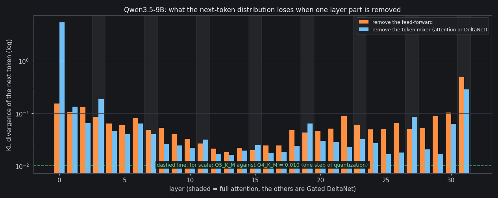

# What happens when you remove a layer: Qwen3.5-9B

A measured answer to "which parts of the model matter?", made with the tools in this repository, on a model you can download (`unsloth/Qwen3.5-9B-GGUF`, Q4_K_M). It is a small piece of reverse engineering by *intervention*: change one thing in the weights, run the model, see how far its predictions move.



## Method

For each of the 32 layers, one at a time, two interventions:

- **remove the feed-forward**: the layer's `ffn_down` weights are replaced by zeros, so the feed-forward adds nothing to the residual stream;
- **remove the token mixer**: the layer's attention output (`attn_output`) or Gated DeltaNet output (`ssm_out`) weights are replaced by zeros.

Then the modified model reads three texts (English prose, code, mathematics; 3 windows of 256 tokens each) and the next-token distribution at every position is compared with the unmodified model's: **KL divergence** (top 64 tokens) and the percentage of positions where both models pick the same top token.

```bash
forge gguf-zero Qwen3.5-9B-Q4_K_M.gguf zero.gguf w_down,wo,w_out            # a copy with those tensors zeroed (every ggml format decodes an all-zero block to 0.0)
echo '{"overrides":[{"from":"zero.gguf","layers":"13","tensors":["w_down"]}]}' > recipe.json
FORGE_RECIPE=recipe.json forge ppl Qwen3.5-9B-Q4_K_M.gguf --native --tokenizer tokenizer.json \
    --text en.txt,code.txt,math.txt --ctx 256 --max-tokens 768 --ref ref_en.bin,ref_code.bin,ref_math.bin
```

(`--dump-ref` writes the reference once from the unmodified model; recipes are described in [ENGINE.md](ENGINE.md#recipes-mixing-quantizations-without-re-quantizing). The whole study is 64 runs and takes about 25 minutes on an RTX 2060 SUPER.)

For scale: switching the whole model from Q5_K_M to Q4_K_M (one step of quantization) moves the distribution by KL **0.010**.

## What it shows

- **The first and the last layer are not optional.** Removing layer 0's mixer destroys the model (KL 5.4, the top token agrees 10 % of the time); removing the last layer's feed-forward costs KL 0.48 and its mixer 0.29, by far the largest of any late layer.
- **Importance is U-shaped.** The early layers (0 to 8) and the late ones (22 and 29 to 31) matter most; the middle of the network (layers 10 to 17) matters least: one layer there (12 to 17) costs only KL 0.016 to 0.025.
- **Nothing is free, though.** Even the least important single part costs more than a whole quantization step (KL 0.016 against 0.010).
- **The Gated DeltaNet layers are not second-class.** The recurrent layers are as important as the full-attention ones (3, 7, 11, 15, ...): there is no visible split between the two kinds.
- **Removing layers adds up faster than it sums.** Removing the feed-forward of the least important middle layers *together* (zeroed `ffn_down`, mean KL over the three texts):

| middle feed-forwards removed | KL | top-1 agreement |
|---|---|---|
| layer 13 | 0.018 | 92 % |
| layers 12 and 13 | 0.044 | 90 % |
| layers 12 to 14 | 0.070 | 87 % |
| layers 12 to 15 | 0.108 | 85 % |
| layers 12 to 17 | 0.238 | 78 % |
| layers 10 to 17 | 0.397 | 71 % |

## What it means for speed

Skipping a layer's feed-forward would save its share of the weights read per token: about 1.6 percent per layer in this 9B model (the feed-forward weights are 2.9 of the 5.7 GB over 32 layers) and 1.4 percent per host-resident layer in the 27B (3.9 ms of a 285 ms cycle). The numbers above say it is a bad trade: six middle layers buy about 10 percent speed for a KL of 0.24, the quality of a much smaller model. Compare the recipes of [PERFORMANCE.md](PERFORMANCE.md): moving the 27B's down projections from Q6_K to Q4_K bought 5 percent speed (9.01 to 9.47 tokens/s at speculation depth 3) for a KL of 0.0012. Reading fewer *bits* of every layer is more than a hundred times cheaper, per percent of speed, than reading fewer layers. So the engine has no layer-skipping switch, and `forge gguf-zero` exists for studies like this one, not for deployment.

## Per layer

| layer | kind | remove feed-forward: KL | top-1 | remove mixer: KL | top-1 |
|---|---|---|---|---|---|
| 0 | deltanet | 0.1537 | 84.3 % | 5.3749 | 9.7 % |
| 1 | deltanet | 0.1061 | 88.0 % | 0.1342 | 84.5 % |
| 2 | deltanet | 0.1315 | 85.8 % | 0.0650 | 89.2 % |
| 3 | attention | 0.0853 | 86.4 % | 0.1848 | 81.7 % |
| 4 | deltanet | 0.0646 | 88.9 % | 0.0466 | 90.0 % |
| 5 | deltanet | 0.0599 | 89.3 % | 0.0406 | 91.0 % |
| 6 | deltanet | 0.0819 | 87.8 % | 0.0640 | 87.9 % |
| 7 | attention | 0.0487 | 90.2 % | 0.0406 | 90.2 % |
| 8 | deltanet | 0.0534 | 89.7 % | 0.0260 | 92.2 % |
| 9 | deltanet | 0.0402 | 90.9 % | 0.0246 | 92.1 % |
| 10 | deltanet | 0.0330 | 91.2 % | 0.0220 | 92.4 % |
| 11 | attention | 0.0266 | 92.0 % | 0.0315 | 91.1 % |
| 12 | deltanet | 0.0213 | 93.0 % | 0.0171 | 93.2 % |
| 13 | deltanet | 0.0184 | 92.1 % | 0.0162 | 93.8 % |
| 14 | deltanet | 0.0221 | 92.9 % | 0.0197 | 92.9 % |
| 15 | attention | 0.0199 | 93.8 % | 0.0251 | 92.9 % |
| 16 | deltanet | 0.0245 | 92.4 % | 0.0173 | 94.5 % |
| 17 | deltanet | 0.0246 | 91.2 % | 0.0187 | 93.5 % |
| 18 | deltanet | 0.0476 | 90.5 % | 0.0242 | 91.8 % |
| 19 | attention | 0.0429 | 90.6 % | 0.0647 | 89.4 % |
| 20 | deltanet | 0.0462 | 90.2 % | 0.0300 | 92.4 % |
| 21 | deltanet | 0.0514 | 89.3 % | 0.0287 | 91.9 % |
| 22 | deltanet | 0.0911 | 86.9 % | 0.0229 | 93.4 % |
| 23 | attention | 0.0610 | 90.2 % | 0.0324 | 93.0 % |
| 24 | deltanet | 0.0498 | 90.4 % | 0.0270 | 92.5 % |
| 25 | deltanet | 0.0506 | 91.3 % | 0.0169 | 94.3 % |
| 26 | deltanet | 0.0668 | 89.5 % | 0.0180 | 94.9 % |
| 27 | attention | 0.0502 | 90.6 % | 0.0862 | 89.6 % |
| 28 | deltanet | 0.0524 | 91.5 % | 0.0208 | 94.5 % |
| 29 | deltanet | 0.0887 | 86.7 % | 0.0171 | 95.3 % |
| 30 | deltanet | 0.1043 | 85.2 % | 0.0632 | 92.2 % |
| 31 | attention | 0.4837 | 77.4 % | 0.2873 | 82.2 % |

KL is the mean over the three texts. To reproduce, loop the commands above over the layers (`layers` takes a single layer or a range such as `12-17`).
