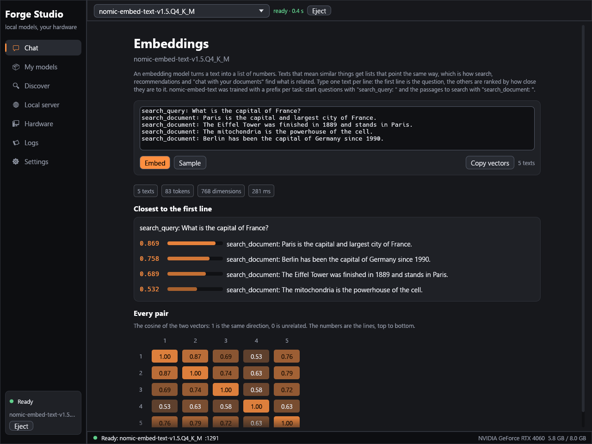

# Forge Studio

Forge Studio is the desktop app of this project: one window to find, download, load and chat with local models, and to serve them to other programs. It is written in Rust with [egui](https://github.com/emilk/egui) (the `glow` OpenGL backend), has no web view and no background service, and keeps everything in one folder.

```bash
cd studio
cargo run --release
```

Tagged versions get release archives for Windows (Studio and the CUDA engine), Linux (both) and macOS (Studio) from `.github/workflows/release.yml`; the workflow has been run successfully on a dry-run branch, the first tag has not been made yet. Until then, build from source or take the artifacts of a CI run.

## The screens

### Chat

- Pick a model in the bar at the top; **Load** starts the engine on it. The bar shows the load time when it is ready.
- Answers stream in. Markdown is rendered: headings, bold and italic, inline code, fenced code blocks (with a Copy button), lists (nested), tables, quotes, links (click to open). A reply that is still streaming is rendered as it grows; an unclosed code fence is a code block up to the end.
- Thinking models (Qwen3, Qwen3.5) show a folded **Thought for N s** block above the answer; it is open while the model is still thinking. The switch is in **Parameters**.
- Under each answer: tokens, tokens per second (the server's own figure when it reports one), time to first token and, when the engine did not have to read most of the conversation again, "6,354 of 6,399 prompt tokens already in memory"; **Copy**, **Regenerate**, **Delete**. Beside **Send**, **Think: auto / off / on** switches whether Qwen3 and Qwen3.5 models reason before they answer (the 4B and larger think by default, which can mean a thousand tokens for a simple question; off answers in a few tokens). **Presets**: the Parameters panel keeps named sets of the system prompt and the sampler settings (type a name, Save; pick one from the list to apply it; the same name replaces). **Attach files**: drop a text or code file (UTF-8, any number), a PDF, a Word, Excel or PowerPoint file, an OpenDocument or RTF file, an EPUB book or a saved web page on the window and it appears as a chip above the message box. A file that fits the context is sent to the model in front of your text, inside `<file name=...>` tags, and shows as a line under your message (click it to see the text that was taken out of the file) (text files up to 2 MB, 24 MB when an embedding model is running); a longer one is searched instead: see [Chat with documents](#chat-with-documents). Edits of code or text copied from the file are where the prompt lookup speeds answers up most (a 4B model type-annotated a file at 197 tokens/s). Under your own messages: **Edit** (change the text, **Save and resend** drops everything after it and asks again), **Copy**, **Delete**.
- **Parameters** (the button at the top right): temperature, top P, top K, min P, repeat penalty, max tokens, thinking (*model default*, always, or answer directly: the small Qwen3.5 models answer directly by default, the bigger ones think), the system prompt (global, and one for this chat only).
- Chats are saved after every answer, one JSON file each in the data folder; the list on the left opens, deletes and starts chats; double-click a title to rename it; with more than four chats a search box filters the list by title. **Copy chat** puts the conversation on the clipboard as Markdown.
- Enter sends, Shift+Enter adds a line, **Stop** cancels (the engine stops generating as soon as the connection closes). Under the input box: how much of the loaded context the conversation uses.

### Chat with documents


Drop a file on the window and ask about it. The line that appears under your message can be clicked: it shows the text that was taken out of the file, so that a PDF, a spreadsheet or a scan that comes out differently from how it looks is noticed.

**What can be attached**

| file | what the model gets |
|---|---|
| text and code (UTF-8) | the text |
| PDF | the text layer, page by page (a word that a line break cut with a hyphen is put together again, ligatures such as "fi" are spelled out). A page that is only a picture, as in a scan, is read by the text recognition that comes with Windows, for the languages of your account: nothing is downloaded and nothing leaves the computer, three scanned pages take about a second. On macOS and Linux a scan says that it cannot be read |
| Word (.docx), PowerPoint (.pptx) | the paragraphs and then the footnotes, endnotes and comments (with the name of their author; headers and footers are left out); the slides in order, with the text of their SmartArt diagrams and their speaker notes |
| Excel (.xlsx), OpenDocument spreadsheet (.ods) | every sheet under a "Sheet: name" line, one line per row, the cells separated by tabs, dates shown as dates and numbers as the cell shows them (25.6%, $1,234.50, 00005), formulas as the value last computed; in a sheet of more than 40 rows the sheet's name and its header row are said again every 30 rows |
| OpenDocument text and presentation (.odt, .odp), RTF (what WordPad saves) | the paragraphs, the slides |
| EPUB book, saved web page (.html) | the chapters in the order of the book, the text of the page without scripts and styles (pages are decoded as UTF-8, UTF-16 or Windows-1252, which is what Word saves) |
| picture (.png, .jpg, .bmp, .gif, .tif, .webp) | on Windows the text that the system's text recognition reads in it (a screenshot of an error message, a photo of a page); elsewhere a message that says it cannot |

The old binary formats .doc, .xls and .ppt are not read: save them as .docx, .xlsx, .pptx or PDF first.

**A file that fits is sent whole.** Together with the conversation it must fit in 70 percent of what is left of the context; it then goes to the model in front of your question.

**A file that does not fit is searched.** The chat cuts it into passages of about 1,800 characters (overlapping, split at paragraphs, lines and words), the embedding model that runs inside the engine (nomic-embed-text, see below) turns every passage into a vector, and for each question the model is given only the best three passages, those whose vector is closest to the question's (cosine above 0.6), in front of the question, with the file they come from. A PDF is read page by page and its passages name their page ("from paper.pdf, page 9"). From the first searched question on, every question of that chat is searched the same way, and the passages of earlier questions are dropped from what the model reads once a newer question is asked, so the context does not fill up. The files can be much longer than the context (up to 24 MB each); Studio indexes each file once per chat.

- **Names and codes are also searched by their words.** A question that names something (an invoice number, a part code, a person, an acronym: "what happened with invoice INV-7731-QX?", "what is the Fleiss kappa value?") also gets the passages that contain those names, found by a keyword search over the names, acronyms, codes and numbers of the question (a capital letter inside the sentence, an acronym, a digit) that few passages have. Vectors score the right passage only 0.5 to 0.6 for such a question and sometimes miss it altogether; the chat marks a passage found this way "has a word of the question". Everyday words are never searched this way, however rare they are in the file. In a test with 120 passages and 20 questions that name an identifier or a person, the vectors alone cited the right passage 17 times and as a strong match 7 times; with the keyword search it was 20 and 20, and questions in other words were unchanged.
- **Vague questions** that match nothing that well get the two nearest passages when they score at least 0.4, and the model is told that they are weak matches that may not be relevant.
- **The opening of a file.** A question such as "what does the abstract say" or "the introduction" also gets the opening passage of each file (two files at most) in front of the best matches, because searching by meaning cannot find an abstract.

**A request to summarize reads the whole file.** A summary, an overview, key points, "what is this about": searching by meaning cannot read a whole file, so the chat model reads every file part by part (a part is at most 14,000 characters, fewer in a small context), writes a short summary of each part, and answers from those summaries, which are kept for the next such request. A 90 KB paper is seven parts and takes about half a minute with a 4B model on an RTX 4060; a line under your question shows how far it is and **Stop** gives the question back. A request that names one of several files reads only that file; one about a part ("the main idea of section 3") is answered from the passages that match; more than 48 parts in all are not read this way. The switch is in Settings > Documents.

**What you see.** A strip under the model bar names the files the chat searches. Under your question a line says how many passages the model read (click it to read them, with their scores and pages), that they were weak matches, or that none matched at all; while a file is read, a line shows how far it is (a 500 KB file takes about two seconds on a GPU).

It needs the ForgeInfer engine and an embedding model: **Settings > Documents** shows which one is in use (an embedding model of **My models**, else the one LM Studio ships when LM Studio is installed) and has a button that downloads nomic-embed-text-v1.5 (84 MB). The engine is told about the embedding model when the chat model loads (the next one you load); its weights are read only when the first long file is searched, onto the GPU when 700 MB of video memory are free then (it needs about 0.4 GB), else onto the processor, so a chat that never attaches a long file never pays for it. The same settings hold the number of passages (3) and the minimum score (0.6; related passages of nomic-embed-text score 0.65 to 0.9, unrelated ones stay below 0.56).

### Embedding models



An embedding model (nomic-embed-text-v1.5 is the one the engine runs; search "nomic embed" in **Discover**) has no conversation: **Load** it and the Chat screen turns into an **embedding playground**. Type one text per line; **Embed** (Ctrl+Enter) sends them to the model's `/v1/embeddings` route and shows how close every line is to the first one (the cosine of the two vectors, ranked, with a bar) and a colour grid of every pair; **Copy vectors** puts all vectors on the clipboard as JSON. nomic-embed-text was trained with a prefix per task: start the question with `search_query: ` and the passages with `search_document: `. The **Local server** screen then shows `curl` and Python snippets for `/v1/embeddings`. Details, accuracy and speed: [EMBEDDINGS.md](EMBEDDINGS.md).

### My models

Lists every `.gguf` file under the folders in **Model folders** (the app's own `models` folder, LM Studio's folder if it exists) and every model in Ollama's store (`~/.ollama/models`, read through its manifests). Nothing is copied or moved. Each card shows the architecture, parameter count, quantization, file size, trained context, where it came from, and a badge: *fits in video memory*, *runs split between GPU and CPU*, or *too large*. A model the ForgeInfer engine cannot run says why (architecture or tokenizer) when you hover the disabled **Load** button. Drop a `.gguf` file or a folder on the window to add its folder. A Qwen3.5 card shows **prediction head: faster answers** when the head file is found, or a **Get the prediction head** button that fetches it (see below). **Inspect** opens the inspector; **Delete** removes a `.gguf` file from the disk after a second press (a loaded model must be ejected first). A video-memory figure in the status bar turns orange under 700 MiB free (on Windows the driver pages then and every GPU program slows down).

### The inspector

Reads the GGUF header (no weights are loaded):

- **Summary**: architecture, parameters, layers, trained context, vocabulary, quantization, bits per weight.
- **Layer map**: one bar per layer, as tall as its weights, coloured by kind. A Qwen3.5 file shows its hybrid design: three recurrent *Gated DeltaNet* layers for every full *attention* layer.
- **What the bytes are** and **Quantization mix**: stacked bars (feed-forward, attention, output head, embeddings ...; which tensor formats hold how many bytes). Mixed files such as `Q4_K_M` really are mixes.
- **Metadata** (every key) and **Tensors** (name, format, shape, size).

The command line has the same information: `forge info model.gguf`, and `forge tensor model.gguf NAME` prints statistics and a block of numbers of one matrix.

### Discover

Search Hugging Face (`filter=gguf`, sorted by downloads). Pick a repository to list its `.gguf` files with their quantization, a one-line note on quality, size, and a fit badge. **Download** saves to `<download folder>/<owner>/<repo>/<file>` (the layout LM Studio uses, so both programs find it), with progress, speed and time left. A cancelled or interrupted download leaves a `.part` file and **resumes** with an HTTP range request. Split files (`-00001-of-00003`) must be downloaded part by part; projector files for vision (`mmproj`) are labelled.

No account is needed. Gated repositories that require a login are not supported yet.

### Local server

Whatever is loaded is served on `http://127.0.0.1:<port>/v1` (default port **1234**, the one LM Studio uses, so tools that expect it work; if it is busy the next free port is used). The screen shows ready-to-paste `curl`, Python (`openai` package) and generic settings. **Let other computers connect** makes the server listen on every interface; set an API key first.

### Hardware, Logs, Settings

- **Hardware**: processor, threads, memory, GPUs (name, video memory total and in use, driver), a table of how typical model sizes fit this computer, and which engine programs were found.
- **Logs**: the command line that started the engine and everything it prints (load steps, errors).
- **Settings**: see below; **About** has a "Check for updates" button that asks github.com for the newest release (one request, only when you press it).

## Engines

Settings → Engine picks what runs the models:

| engine | runs | needs |
|---|---|---|
| **ForgeInfer engine (CUDA)** | GGUF models (`llama`, `qwen3`, `qwen35` architectures) on an NVIDIA GPU, with KV-cache compression, the CPU/GPU split and speculative decoding | the `forge` program: next to the app, in `target/release/`, in the `PATH`, `FORGE_BIN`, or the path in Settings |
| **llama.cpp server** | any GGUF llama.cpp supports, on any GPU or the CPU; works on macOS. Tested on Windows with the CUDA build of release b11517 (Qwen3.5-4B: streaming, reasoning blocks and tokens per second all work) | `llama-server` from a [llama.cpp release](https://github.com/ggml-org/llama.cpp/releases) in the `PATH` or in Settings |
| **Connect to a running server** | nothing is started: Studio talks to the address you enter | an OpenAI-compatible server (Ollama on `:11434`, LM Studio on `:1234`, vLLM, the engine on another computer) |

Settings → When a model loads: context length (**auto** for the ForgeInfer engine: the longest context that fits next to the model, up to what the model was trained for, shown in the chat as "N of M tokens"; presets from 4k to 256k; the **Longest possible** button sets auto and the cache with 8-bit keys and 4-bit values, 40 percent of the 16-bit cache's memory for a small loss), KV-cache mode (16-bit; 8-bit, no measurable loss; 8-bit keys with 4-bit values; all 4-bit, a visible loss on some models: [numbers](PERFORMANCE.md#long-contexts)), **A conversation longer than the context** (by default the oldest turns are left out of what the model reads once the chat no longer fits: by whole turns and down to 70 percent of the context, so that the engine's memory of the chat stays valid for the next messages; they stay on screen above a marker line, the system prompt and the message being answered are always kept; the other choice shows the server's "context too long" error), speculative depth (Qwen3.5 models draft tokens with their own prediction head; 2 to 3 is fastest), **Chat memory** (how much computer memory, not video memory, the ForgeInfer engine may use to keep the chats it is not working on: going back to a long chat or document copies it back in a fraction of a second instead of reading it again; 2 GB by default, off = 0), extra engine arguments, "load the last model when the app starts", and **Unload after N idle minutes** (frees the video memory for games; any request to the local server counts as activity).

## When something does not work

- **"Failed to load" with `CUDA_ERROR_NO_DEVICE` or `cuInit`**: the ForgeInfer engine needs an NVIDIA GPU and a current driver. Studio says so in the chat and offers the Settings: choose the llama.cpp server (any GPU, or the CPU) or a server that is already running. The reason is the engine's own last line of output (hover it for the whole text; Logs has everything).
- **Answers suddenly slow while the video memory figure in the status bar is orange**: under about 700 MiB free the Windows driver pages video memory. Close other programs, lower the context length, or turn on the 8-bit KV cache in Settings.
- **The model loads but the first answer thinks for a minute**: a Qwen3.5 model of 4B or more reasons first; the Think switch beside Send turns that off.

## Prompt lookup (any model)

Settings > When a model loads > **Prompt lookup** (on by default, ForgeInfer engine): when an answer repeats words from the prompt or from earlier in the answer (code edits, quotes, corrected text, lists, JSON), the engine proposes the next tokens from there and verifies them in one pass over the weights. Measured up to 2x faster on such answers with models that have no prediction head at all, and no cost on free prose (see [PERFORMANCE.md](PERFORMANCE.md#prompt-lookup-speculation-for-every-model-up-to-2x-on-edits)). It adds `--no-lookup` to the engine's command line when you switch it off.

## Speculative decoding (the prediction head)

Qwen3.5 models answer 1.5 to 2.2 times faster with their prediction head (measurements in [PERFORMANCE.md](PERFORMANCE.md#speculative-decoding-on-the-rtx-4060)). The GGUF files do not contain it. Studio looks for `<model name>-mtp.safetensors` (the name without the quantization: `Qwen3.5-9B-mtp.safetensors` for `Qwen3.5-9B-Q4_K_M.gguf`) beside the model, in an `mtp` folder beside it, in your model folders and in the download folder, and starts the engine with `--mtp FILE --depth 3` when it finds one (Settings > When a model loads has the switch). **Get the prediction head** on a model's card downloads only the `mtp.*` tensors of the original checkpoint on Hugging Face (`Qwen/Qwen3.5-9B` and so on, 0.2 to 0.9 GB) into `<download folder>/mtp/`. If the engine cannot use a head (a file of another model), Studio starts the model again without it. The status bar of the chat shows **speculative** while it is on.

## Where things are

| what | where |
|---|---|
| settings, chats | Windows `%APPDATA%\ForgeStudio`, macOS `~/Library/Application Support/ForgeStudio`, Linux `~/.config/forge-studio` (override: `FORGE_STUDIO_HOME`) |
| portable mode | create a folder named `data` next to the program and everything (settings, chats, downloads) is kept there instead |
| downloads | `<data folder>/models` unless you change it in Settings |

## Command line

The window itself needs no options. These exist for tests and screenshots:

```
forge-studio --screen library|chat|discover|server|hardware|logs|settings
             --demo                          a sample conversation (nothing is saved)
             --load FILE.gguf                load a model at start      --select NAME  load the library model whose name contains NAME
             --send "text"                   send a message as soon as a model is ready
             --search "text"                 run a Hugging Face search at start
             --inspect FILE.gguf             open the inspector on a file
             --shot out.png [--shot-delay S] [--shot-after-reply]    save a screenshot and quit
             --size 1280x800
```

## How it is built

`studio/` is its own Cargo workspace (the engine crates stay free of third-party crates). Modules:

| module | job |
|---|---|
| `app.rs` | all state; worker threads report back through one channel; the screens only draw state and queue `Action`s that are applied after the frame |
| `engine.rs` | spawns `forge serve` / `llama-server`, collects its output, polls `/v1/models` until it answers, kills it on exit; the child ends with the app (Windows job object, Linux `PR_SET_PDEATHSIG`) |
| `client.rs` | OpenAI-compatible client: model list and streamed chat completions (SSE), including `reasoning_content`, usage and timings; retries with only the standard fields if a strict server rejects the extra samplers |
| `library.rs` | scans folders and Ollama's store, reads GGUF headers with the `forge-gguf` crate, builds the inspector's data |
| `hf.rs` | Hugging Face search, file listing, resumable download |
| `markdown.rs` | Markdown parser and egui renderer (links are hit-tested on the text layout) |
| `hardware.rs` | CPU, memory, GPUs (`nvidia-smi`), fit estimates |
| `chats.rs`, `settings.rs` | files on disk |
| `ui/` | one file per screen |

Tests: `cd studio && cargo test --lib` (about 110 unit tests, including a synthetic GGUF file for the scanner and inspector, the passage search with a fake embedding model, and PDF, Word, Excel, PowerPoint, OpenDocument, RTF, EPUB and HTML files written by the tests). `cargo test --lib live_ -- --ignored` runs a network test that searches, lists, downloads and resumes a 1.2 MB model from Hugging Face.

## Platform notes

- **Windows**: tested on Windows 11. Release builds have no console window.
- **Linux**: built and unit-tested by CI and compile-checked on Ubuntu 24.04 (X11 and Wayland through `winit`, OpenGL through `glutin`, no system libraries needed to build); needs a working OpenGL driver at run time. **Run on a Linux desktop (Ubuntu 24.04, X11, RTX 2060 SUPER, 2026-10-13):** the window renders as on Windows (Markdown, code blocks, tables, live GPU memory in the status bar), a Qwen3.5-4B chat through the Linux `forge` engine streamed at 111 tokens/s, and the engine process ended with the app. Wayland and other GPUs are untested.
- **macOS**: built and unit-tested by the CI workflow (Apple silicon), the window itself has not been run by the author. The default engine there is llama.cpp's `llama-server` (the ForgeInfer engine needs CUDA); or connect to a running server.
